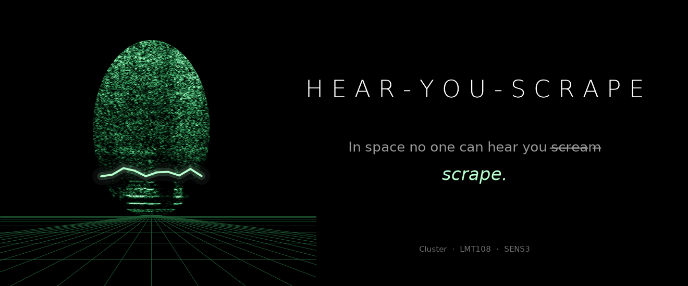
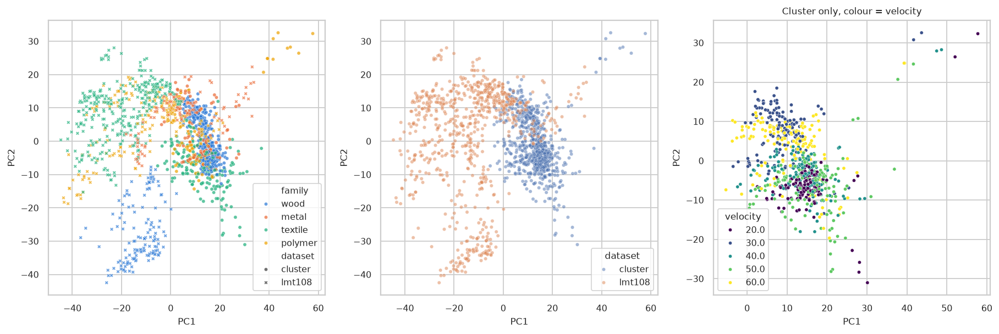
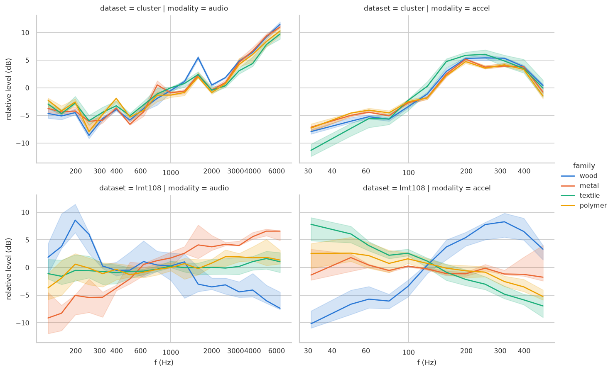
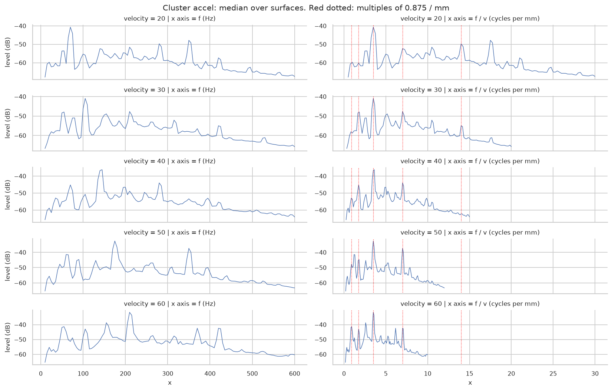
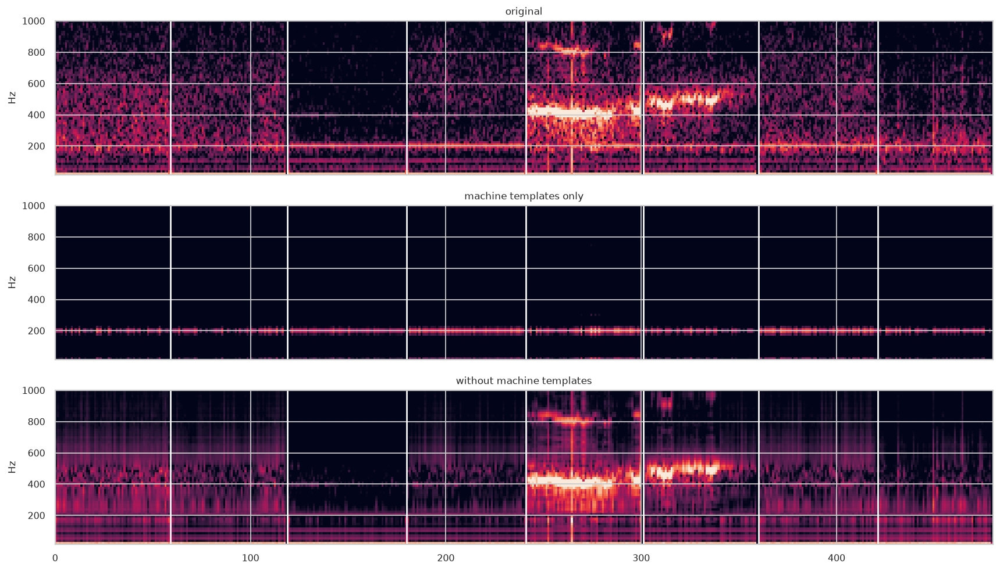
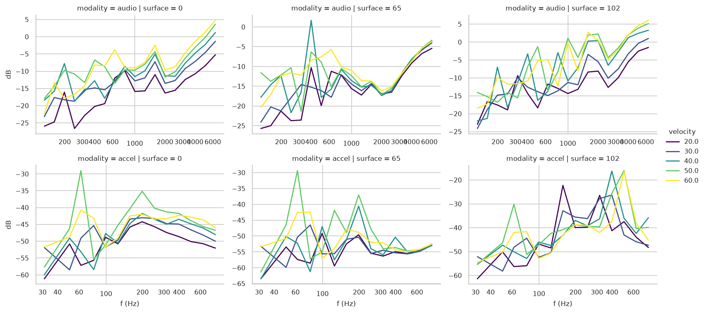
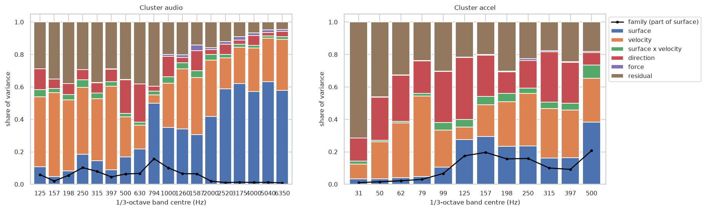

# hear-you-scrape

*Contact: In Space No One Can Hear You Scrape.* Recognizing what a surface is made of from the sound
and vibration of a probe sliding on it.

## Why

Robots mostly recognize objects by vision, but appearance can mislead: a painted board or a plastic
laminate looks like wood. Sliding a probe on a surface produces sound and vibration that depend on
the material. We predict the **material family** (wood, metal, textile, polymer) from audio,
acceleration or both.

Two things make this hard, and they are what the project is about:

- **New surfaces.** Recordings of one surface share details a model can memorize, so all recordings of
  a surface stay in the same split: we test on surfaces never seen in training.
- **New conditions.** The signal changes with the sliding velocity and with the sensors. A model trained
  on one setup must still work on another.

## Direction

- **Data.** [Cluster](https://doi.org/10.6084/m9.figshare.29438288) (72 kept surfaces, five velocities,
  eight directions, two forces) for controlled experiments, [LMT108](https://zeus.lkn.ei.tum.de/downloads/texture/)
  (36 surfaces, handheld probe) as a second setup, [SENS3](https://www.sens3.net/surfaces) (bare finger)
  as an external test. `scripts/surface_families.py` decides which surface goes in which family.
- **Models.** Spectral features with a linear classifier, a small CNN on log-mel spectrograms, and
  pretrained audio encoders (BEATs, CLAP).
- **Idea.** Pair recordings of the same surface at two velocities and add a consistency penalty so the
  model gives the same prediction for both. Does it help on new surfaces, a new velocity, a new setup?
- **Protocol.** (1) new Cluster surfaces; (2) new surfaces at an unseen velocity; (3) train on Cluster,
  test on LMT108, then train on both and test on SENS3.

## What the signals already tell us (no machine learning yet)

**The datasets differ more than the families.** On a PCA of spectral shapes, the first axis separates
the two datasets; the families come second. Clustering the surfaces without labels finds the dataset
(adjusted Rand index 0.80-0.86), not the family (about 0.1). The datasets differ in their setup, but also
in their surfaces, gestures and processing (the Cluster audio is already denoised by its authors), so
this gap cannot yet be attributed to the setup alone. Either way, transfer between datasets is hard.

**Inside one dataset, families do differ**, but not in the same way in both: LMT108 wood has a strong
150-400 Hz bump, its textiles fall off steeply; in Cluster the four families look almost alike.

**A lot of the Cluster vibration is probably the machine.** Peaks shared by all 72 surfaces line up at
f = 3.5 v (right column), which points to the drive mechanism rather than the texture. In each recording,
the +-10 Hz windows around these lines hold a median 32-85 % of the 10-600 Hz acceleration energy,
depending on the velocity; not all of that energy is necessarily machine.

**NMF can isolate a machine candidate.** On eight surfaces, one narrow template is active on all of them:
a candidate for machine noise, not yet a validated one. Removing it leaves a part that differs between
surfaces.

**A simple frequency shift with velocity explains the spectra poorly.** The texture model f = k v
predicts that going from 20 to 60 mm/s moves the spectrum up by a factor 3. Spectra at 20 and 60 mm/s
correlate better at the same frequency than after this shift (median 0.20-0.49 against about 0), but
only moderately, and the level rises by 4 to 7 dB per doubling of velocity. Velocity explains as much
of the spectrum as the surface.

**What this changes for the models.** Compare training with and without removing the machine lines
(learned on the training surfaces only), normalize the level, and treat the velocity-consistency penalty
as invariance to nuisance factors (velocity, machine, sensor gain) rather than to a frequency shift.
Also: in LMT108, audio and acceleration show almost no coherence (about 0.01), which may mean they are
not synchronous; and "polymer" means rigid plastics in Cluster but mostly rubbers in LMT108.
