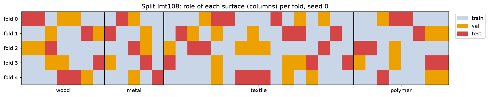
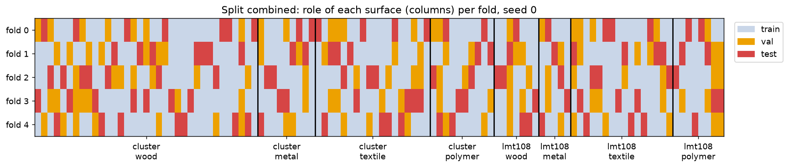

# Train / validation / Test splits

Every model uses the same splits, written by `scripts/splits.py` to `folds.csv`:

```bash
uv run python scripts/splits.py
```

The script only reads `analysis/surface_families.csv`, so it runs without the raw data. Models get the
recordings of each role with `split_recordings(recordings, folds, split, seed, fold, new_velocity=False)`.

## Rules

- **Split by surface, not by recording.** All recordings of a surface stay in the same role, so the
  test surfaces are never seen in training. This is the object-wise split from the hyperspectral
  project, with one surface playing the role of one object.
- **Probable duplicates stay together.** In Cluster, surfaces with the same name form one group
  (White ash 8 and 13, Cotton 88 and 104). In LMT108, `SolidRubberPlateVersion1/2` form one group,
  and so do `Beech_0` and `CoreBeech`. That gives 70 groups for the 72 Cluster surfaces.
- **Stratified by dataset and family**, with `StratifiedGroupKFold`.
- **Validation surfaces come from the training side.** About a quarter of the training groups are used
  for early stopping and for choosing λ. The test dataset is never used for training or tuning.

## Splits

| `split` | Question | Train / val | Test | Folds |
|---|---|---|---|---|
| `cluster` | Exp. 1: new Cluster surfaces | Cluster, all velocities | other Cluster surfaces, all velocities | 5 folds × 3 seeds |
| `cluster` + `new_velocity=True` | Exp. 2: new surfaces at a new velocity | Cluster, 20–50 mm/s | other Cluster surfaces, 60 mm/s only | same 15 folds |
| `lmt108` | New LMT108 surfaces | LMT108 | other LMT108 surfaces | 5 folds × 5 seeds (few surfaces, so more seeds) |
| `combined` | Can one model handle both setups? | Cluster + LMT108 | new surfaces of both datasets | 5 folds × 3 seeds |
| `cluster_to_lmt108` | Exp. 3a: new setup | Cluster | all 36 kept LMT108 surfaces | 1 fold × 3 seeds (the seed changes the val surfaces) |
| `lmt108_to_cluster` | New setup, other direction | LMT108 | all 72 kept Cluster surfaces | 1 fold × 3 seeds |
| *to do* | Exp. 3b: new setup, bare finger | Cluster + LMT108 | SENS3 | waits for SENS3 in `surface_families.csv` |

Why the within-dataset splits: Leo's analysis shows the two datasets differ more than the families do.
Comparing `cluster` with `cluster_to_lmt108` and `lmt108` with `lmt108_to_cluster` separates two
problems. Either the families are hard to tell apart even within one setup (low in-domain scores), or
the model learns them but does not transfer (good in-domain scores, then a drop). The difference is
the generalization gap between setups.





## Numbers

Surfaces per fold (range over all folds). `combined` gives the same counts for each dataset as the
two single-dataset splits.

| Split | Role | Wood | Metal | Textile | Polymer |
|---|---|---|---|---|---|
| `cluster` (70 groups) | train | 21 | 5–6 | 10–12 | 6 |
| | val | 7 | 1–2 | 3–4 | 2 |
| | test | 7 | 1–2 | 3–4 | 2 |
| `lmt108` (34 groups) | train | 3–5 | 3 | 9–10 | 4–6 |
| | val | 1–2 | 1 | 3–4 | 1–2 |
| | test | 1–2 | 1 | 3–4 | 1–2 |

Cross-dataset splits, seed 0:

| Split | Train | Val | Test |
|---|---|---|---|
| `cluster_to_lmt108` | 54 Cluster surfaces | 18 Cluster surfaces | 36 LMT108 surfaces (7 wood, 5 metal, 16 textile, 8 polymer) |
| `lmt108_to_cluster` | 27 LMT108 surfaces | 9 LMT108 surfaces | 72 Cluster surfaces (35 wood, 9 metal, 18 textile, 10 polymer) |

Recordings for seed 0, fold 0:

| Split | Train | Val | Test |
|---|---|---|---|
| `cluster` | 6,880 | 2,240 | 2,400 |
| `cluster` + `new_velocity` | 5,504 | 1,792 | 480 |
| `lmt108` | 420 | 140 | 160 |
| `combined` | 7,160 | 2,540 | 2,540 |
| `cluster_to_lmt108` | 8,640 | 2,880 | 720 |
| `lmt108_to_cluster` | 540 | 180 | 11,520 |

## What this means for evaluation

- **Few test surfaces per family.** A fold tests 1–2 metal and 2 polymer surfaces, so one surface
  changes a per-family score by 50 % or more. Report mean ± std over the 15 folds, not a single fold.
- **Surfaces are the independent examples.** Thousands of recordings come from only 72 surfaces. Report
  per-surface accuracy, where a surface's prediction is the majority vote of its recordings, alongside
  the per-recording metrics.
- **Imbalanced classes.** Wood is about half of Cluster, so use macro-F1 rather than accuracy.
- **The class balance shifts between datasets.** LMT108 is mostly textile (16 of 36) while Cluster is
  mostly wood, so per-family recall is easier to compare between experiments than overall accuracy.
- **LMT108 alone is very small.** Each fold trains on 3 metal surfaces and tests 1, so the metal score of
  a fold is either 0 or 100 %. This is why `lmt108` uses 25 folds; only the mean ± std is meaningful.
- **Cluster has 8 times more recordings per surface** (160 against 20). In `combined`, LMT108 is only
  about 6 % of the training recordings (420 of 7,160), so weight the loss per surface or per dataset, or the model
  will mostly fit Cluster.
- **`combined` has a shortcut.** Cluster is mostly wood and LMT108 mostly textile, and the dataset is
  easy to recognize. A model can guess "LMT108, so textile" without learning any material. Report
  scores per dataset, and compare with a baseline that predicts the most common family of each dataset.
- **Experiment 2 has a small test set** (480 recordings, one velocity), but the same number of test
  surfaces as experiment 1.

## Proposed baseline: logistic regression

This gives the reference numbers that the CNN and other models have to beat.

## Open questions

- Should the duplicate groups be kept? In particular, `Beech_0` and `CoreBeech` may be different boards.
  Cotton 88 is listed as "Biodegradable" and Cotton 104 as "Cloths".
- Should elastomers stay in "polymer"? They are mostly in LMT108, while Cluster's polymers are rigid
  plastics (see `polymer_type`).
- Which SENS3 surfaces do we keep, and in which families?
