# hear-you-scrape

<p align="center">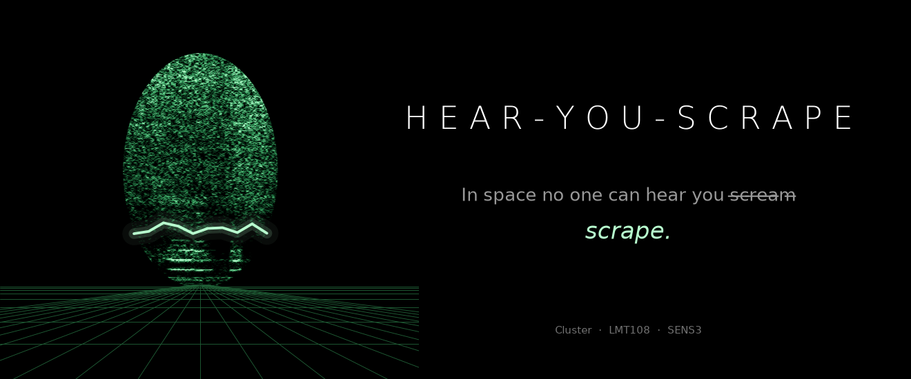</p>

*Contact: In Space No One Can Hear You Scrape.* Recognizing what a surface is made of from the sound
and vibration of a probe sliding on it.

## Why

A surface can look like wood and be plastic. Sliding a probe on it gives another clue: its sound and
vibration. We classify four families: wood, metal, textile and polymer.

The goal is to work on **new surfaces and new setups**, despite changes in speed, sensors and contact.
All recordings of a surface stay in the same split.

## Direction

- **Data:** [Cluster](https://doi.org/10.6084/m9.figshare.29438288) (72 surfaces),
  [LMT108](https://zeus.lkn.ei.tum.de/downloads/texture/) (36), [SENS3](https://www.sens3.net/surfaces) (30).
  Labels are in `scripts/surface_families.py`.
- **Models:** spectral features + classifiers, a small CNN, pretrained BEATs and CLAP.
- **Tests:** new surfaces, new surfaces at an unseen speed, then a new setup.
- **Idea:** compare predictions at two speeds, then try contrastive audio–acceleration training.

## What the signals tell us before classification

**The datasets differ more than the families.** PCA and clustering mainly separate Cluster and LMT108
(ARI 0.80–0.86 for dataset, about 0.1 for family). This is not just a sensor effect: surfaces, gestures
and processing differ too. Cluster audio was already denoised by its authors.

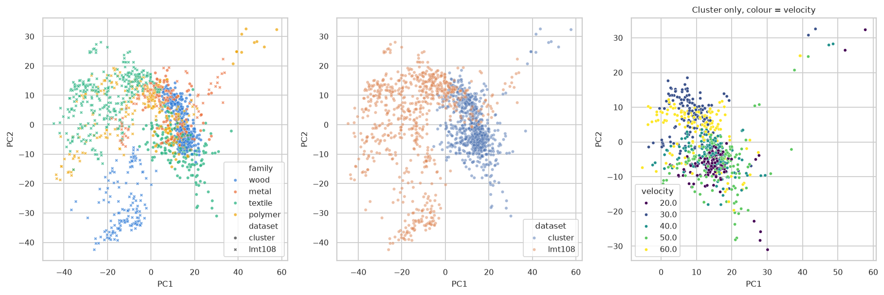

**Inside one dataset, families do differ**, but not in the same way in both: LMT108 wood has a strong
150-400 Hz bump, its textiles fall off steeply; in Cluster the four families look almost alike.

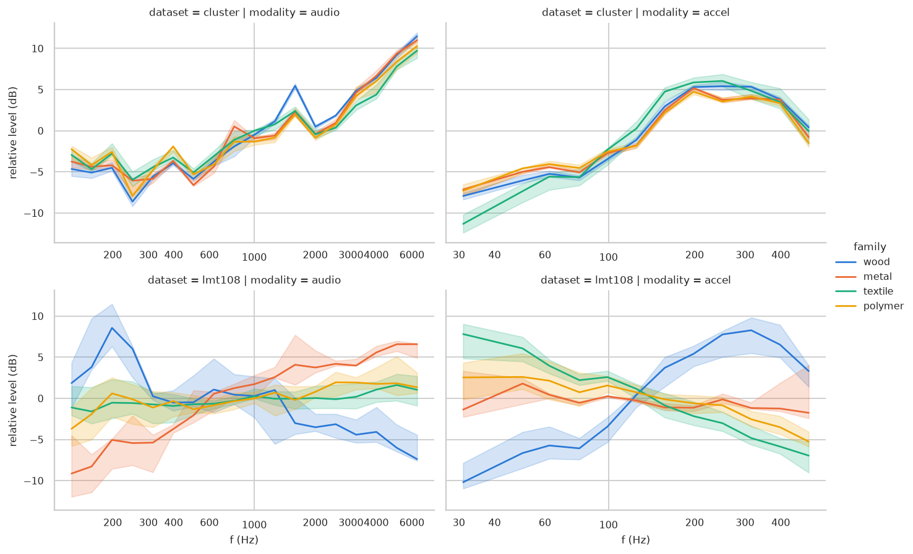

**Cluster vibration contains likely machine noise.** Peaks shared by the surfaces follow f = 3.5 v.
Their ±10 Hz windows contain 32–85% of the 10–600 Hz energy, depending on speed; that energy cannot
all be attributed to the machine.

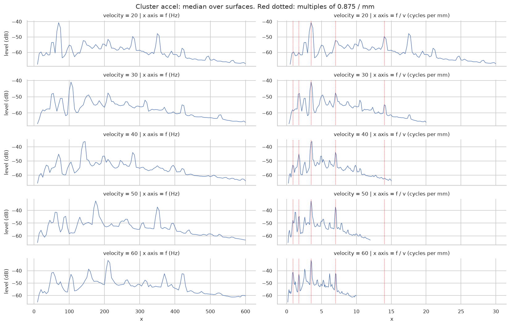

**NMF can isolate a machine candidate.** On eight surfaces, one narrow template is active on all of them:
a candidate for machine noise, not yet a validated one. Removing it leaves a part that differs between
surfaces.

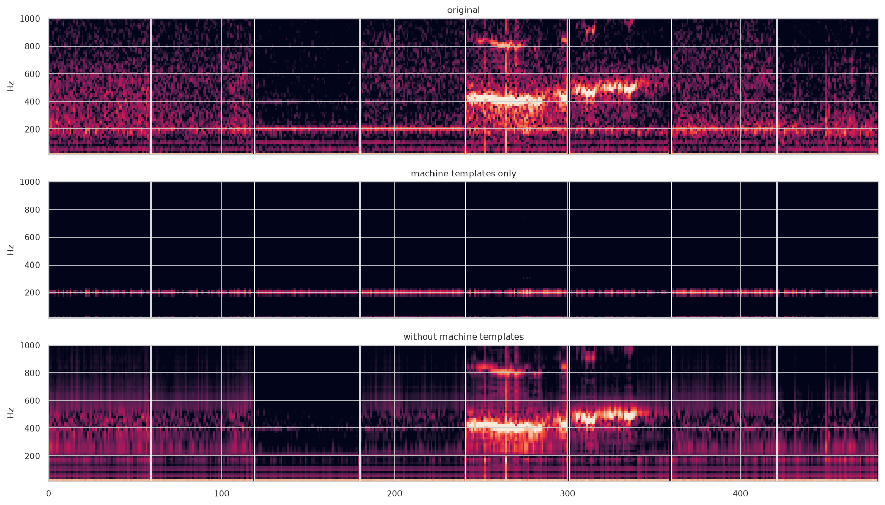

**Speed does more than shift frequencies.** Spectra at 20 and 60 mm/s correlate better without
frequency scaling (0.20–0.49) than with it (about 0). The level rises 4–7 dB per doubling of speed.

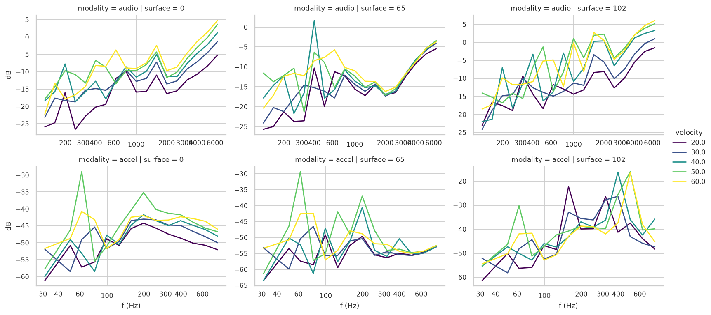
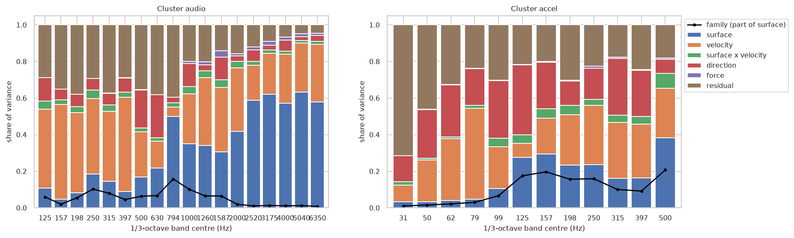

**For the models:** normalize the level and compare with/without machine-line removal, learned only
on training surfaces. LMT108 audio and acceleration have low coherence (about 0.01), so they may not
be aligned. Its polymers are mostly rubbers, while Cluster has mostly rigid plastics.

## Classification

Code in `scripts/classification/`: experiments are grouped into preparation, baselines, transfer,
variants and diagnostics. `run.py` runs them; notebooks run separately.
Scores are balanced accuracies on surfaces never seen in training, with 95% intervals from resampling
whole surfaces; chance is 0.25.

**New surfaces of a known setup: yes.** On new Cluster surfaces, an RBF SVM on 1/3-octave shapes and a
small CNN on spectrograms both reach about 0.74 with audio + acceleration. Trained on both datasets, one
model works on new surfaces of both. The team's surface splits ([`analysis/splits/`](analysis/splits/README.md)) give the
same scores.

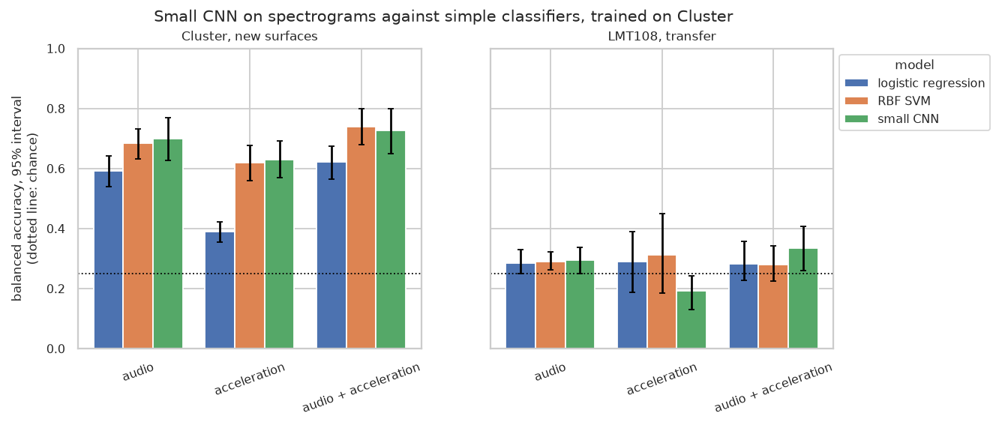
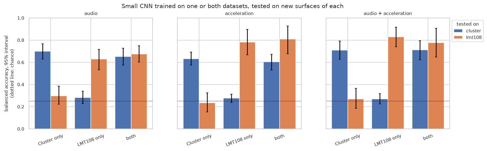

**A new setup: no, or barely.** Trained on Cluster and tested on LMT108, or the reverse, every model is
at chance. Trained on both and tested on SENS3 (bare finger, the external test), the best models reach
0.30-0.35, mostly with acceleration: a weak signal, far from the 0.75 of a known setup. The SENS3 spectral
shapes sit about 6 dB away from those of the training datasets, while the families differ by about 0.8 dB.

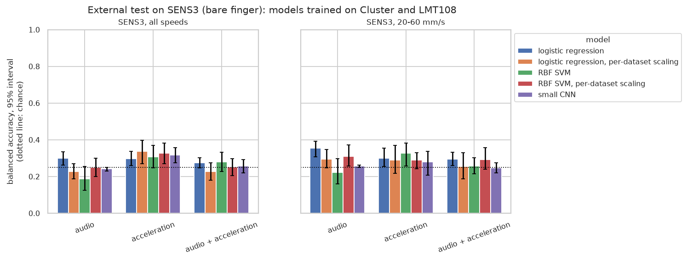

**Simple fixes do not solve transfer.** More layers, regularization, spectral augmentation, AdaBN,
normalization, noise, mixup and DANN give 0.24–0.34 on SENS3 after selection on Cluster ↔ LMT108.

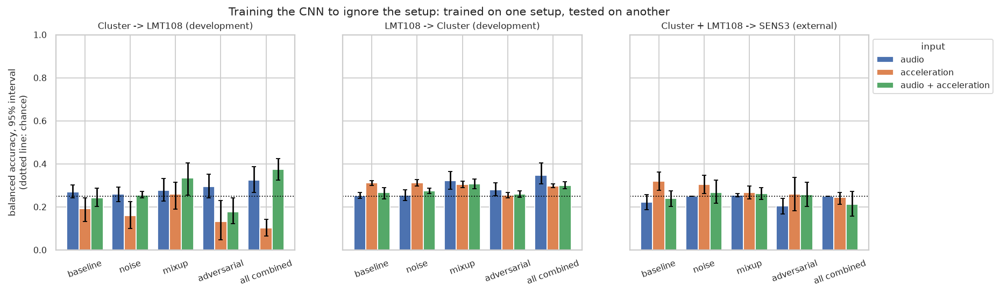

**More setups do not solve it either.** Training on two setups and testing on the third gives
0.16–0.35. Adding 2,977 audio scratches from [Greatest Hits](https://andrewowens.com/vis/hits.html)
does not help. SENS3 has now been used repeatedly, so these tests are exploratory.

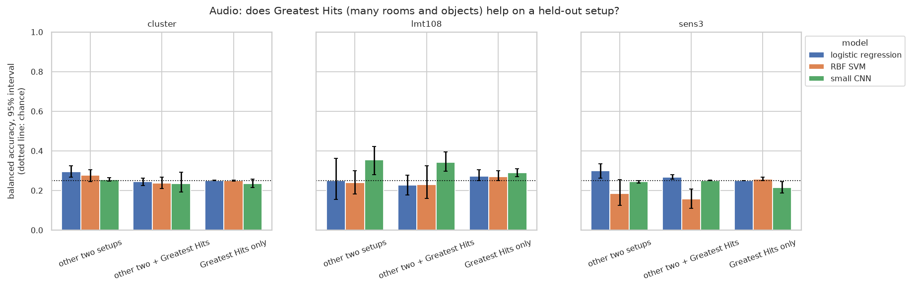

**Pretrained encoders do not solve transfer.** BEATs and CLAP reach 0.72–0.76 on new Cluster
surfaces, but 0.16–0.34 on another setup. The velocity-consistency penalty gives no measurable gain.

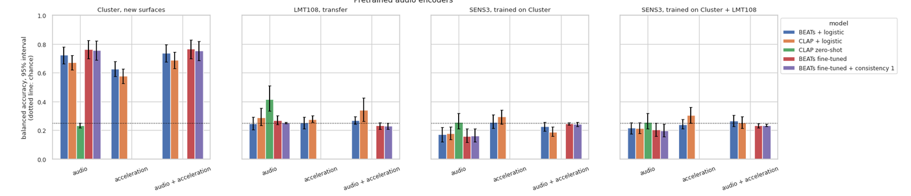
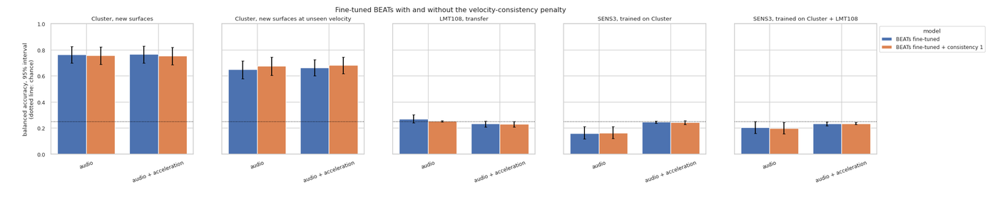

**Removing the setup's spectral filter is not enough.** Following Primus and Widmer's frequency-wise
centering for unseen recording devices, we subtract each setup's mean spectral shape. The shift is
3.5–7 dB, larger than the family differences, but average transfer stays at 0.26. The method comes
from [On Frequency-Wise Normalizations for Better Recording Device Generalization in Audio Spectrogram
Transformers](https://arxiv.org/abs/2306.11764); our experiment applies its idea to setup-level mean
shapes and finds that removing the common filter alone does not align the families.
The best case is acceleration on SENS3: 0.39 [0.32–0.47], an exploratory result on a repeatedly used test.

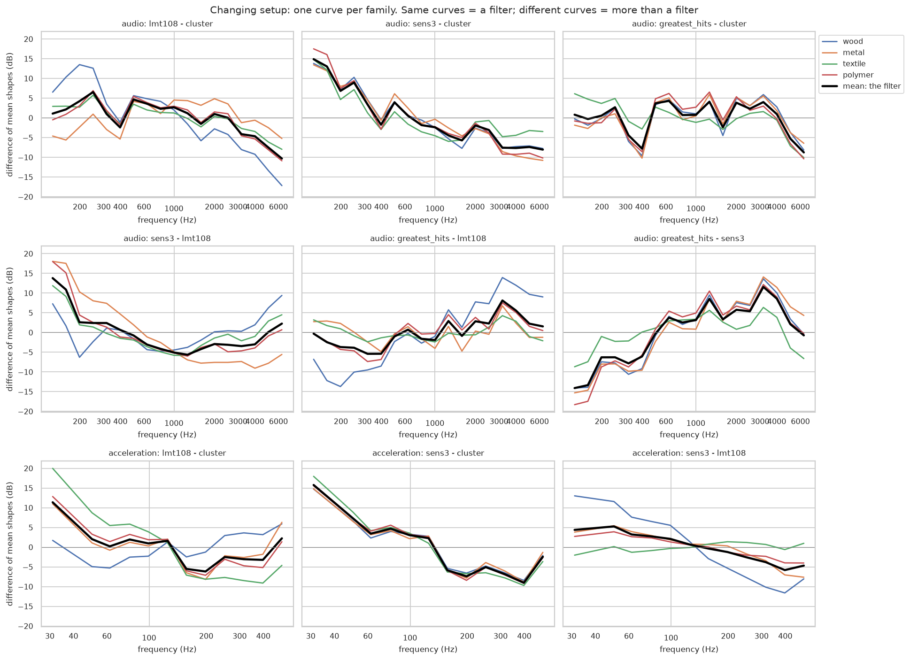
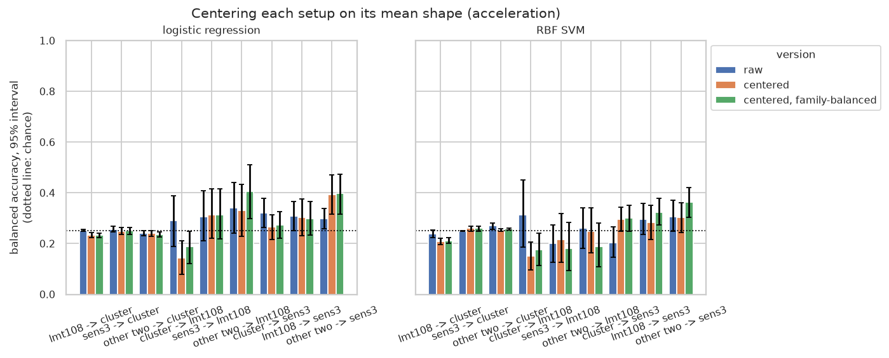

**Temporal and impulsiveness descriptors also transfer poorly:** 0.19–0.30 on average.

**A few labeled surfaces help.** With four surfaces per family of the new setup, audio + acceleration
reaches 0.48–0.64. Adding the other setups does no better and often hurts.

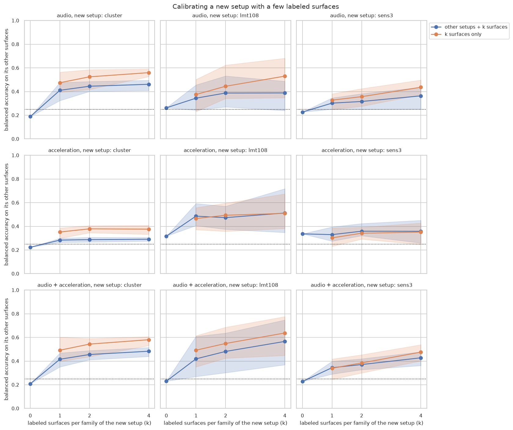

**Next:** contrastive audio–acceleration pre-training with BEATs, trained on two setups and tested on
the third. The full GPU experiment is pending in `cross_sensor_contrastive.ipynb`.

## Reproduce

```bash
uv sync --locked
uv run python scripts/install_data.py
bash scripts/signal_processing/run_all.sh
uv run python scripts/classification/run.py
```

The classification run regenerates the team splits, results and waveform data; CNNs need a GPU.
Historical results use five surface folds; the `spectral_models_on_team_splits` and
`cnn_on_team_splits` commands use the team's grouped splits.
Settings and seeds are fixed in the scripts. Scores are balanced accuracies; few-shot bands show
variation across 20 draws, while the other intervals bootstrap whole surfaces.

Each notebook runs alone on JupyterHub: open it in an empty folder and run all cells with Python 3.12+
and a GPU. It installs packages and downloads the four data files and pretrained models automatically;
no Python files from the repository or data archive are needed. `QUICK = True` checks the pipeline;
use `False` for results. Completed stages are cached; use a fresh results folder if settings change.
Run one experiment with `uv run python scripts/classification/run.py setup_filter` (`--help` lists them).
Rebuild the data archive with `uv run python scripts/classification/run.py bundle`.
