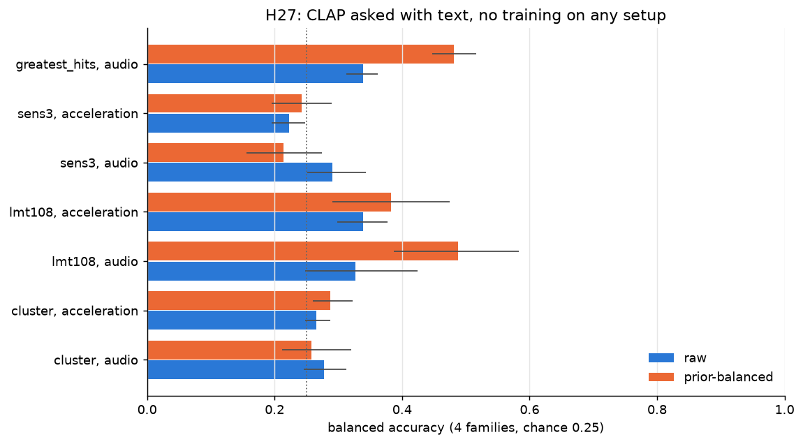
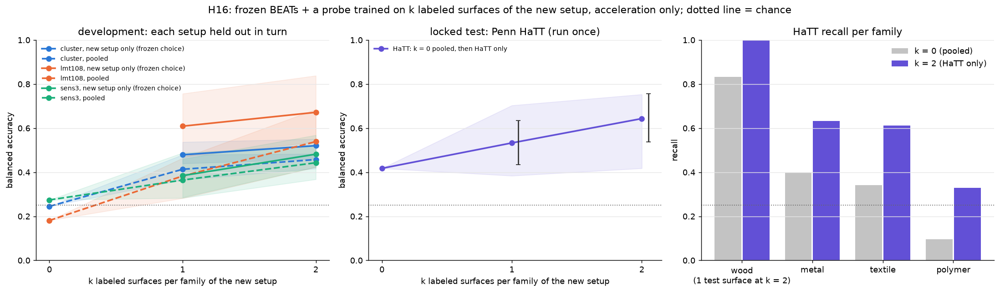
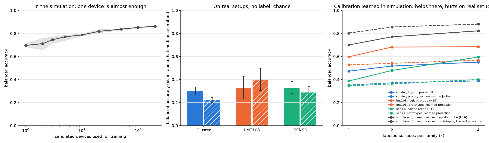
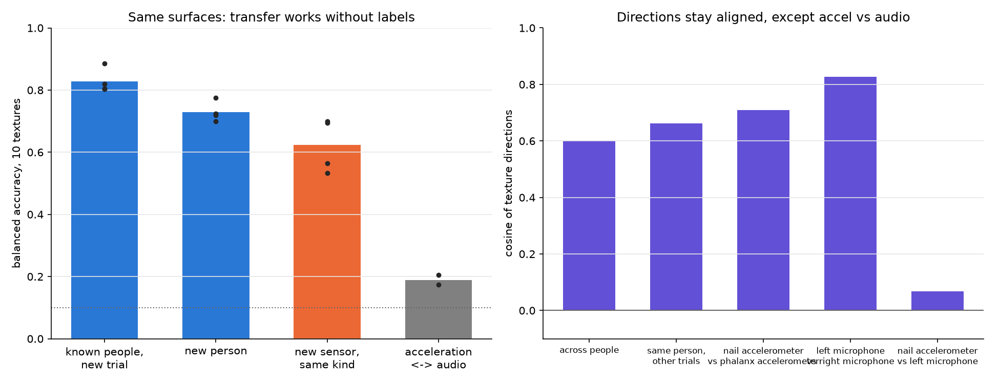

# hear-you-scrape

*Contact: In Space No One Can Hear You Scrape.* Recognizing what a surface is made of from the sound
and vibration of a probe sliding on it.

## Why

A surface can look like wood and be plastic. Sliding a probe on it gives another clue: its sound and
vibration. We classify four families: wood, metal, textile and polymer.

The goal is to work on **new surfaces and new setups**, despite changes in speed, sensors and contact.
All recordings of a surface stay in the same split.

## Direction

- **Data:** [Cluster](https://doi.org/10.6084/m9.figshare.29438288) (72 surfaces),
  [LMT108](https://zeus.lkn.ei.tum.de/downloads/texture/) (36), [SENS3](https://www.sens3.net/surfaces) (30) for
  development; [HaTT](https://repository.upenn.edu/handle/20.500.14332/30085) (43, accelerometer only) as the
  locked final test; [Greatest Hits](https://andrewowens.com/vis/hits.html) and
  [Devillard 2025](https://doi.org/10.6084/m9.figshare.26965267) for controls.
  Labels are in `scripts/surface_families.py`.
- **Models:** spectral features + classifiers, a small CNN, pretrained BEATs, CLAP and Qwen2-Audio.
- **Tests:** new surfaces, new surfaces at an unseen speed, then a new setup with no label (k = 0) or with
  k labeled surfaces per family.

## What the signals tell us before classification

**The datasets differ more than the families.** PCA and clustering mainly separate Cluster and LMT108
(ARI 0.80–0.86 for dataset, about 0.1 for family). This is not just a sensor effect: surfaces, gestures
and processing differ too. Cluster audio was already denoised by its authors.

**Inside one dataset, families do differ**, but not in the same way in both: LMT108 wood has a strong
150-400 Hz bump, its textiles fall off steeply; in Cluster the four families look almost alike.

**Cluster vibration contains likely machine noise.** Peaks shared by the surfaces follow f = 3.5 v.
Their ±10 Hz windows contain 32–85% of the 10–600 Hz energy, depending on speed; that energy cannot
all be attributed to the machine.

**NMF can isolate a machine candidate.** On eight surfaces, one narrow template is active on all of them:
a candidate for machine noise, not yet a validated one. Removing it leaves a part that differs between
surfaces.

**Speed does more than shift frequencies.** Spectra at 20 and 60 mm/s correlate better without
frequency scaling (0.20–0.49) than with it (about 0). The level rises 4–7 dB per doubling of speed.

**For the models:** normalize the level and compare with/without machine-line removal, learned only
on training surfaces. LMT108 audio and acceleration have low coherence (about 0.01), so they may not
be aligned. Its polymers are mostly rubbers, while Cluster has mostly rigid plastics.

## Classification

Code in `scripts/classification/`: experiments are grouped into preparation, baselines, transfer,
variants and diagnostics. `run.py` runs them; notebooks run separately.
Scores are balanced accuracies on surfaces never seen in training, with 95% intervals from resampling
whole surfaces; chance is 0.25.

**New surfaces of a known setup: yes.** On new Cluster surfaces, an RBF SVM on 1/3-octave shapes and a
small CNN on spectrograms both reach about 0.74 with audio + acceleration. Trained on both datasets, one
model works on new surfaces of both. The team's surface splits ([`analysis/splits/`](analysis/splits/README.md)) give the
same scores.

**A new setup: no, or barely.** Trained on Cluster and tested on LMT108, or the reverse, every model is
at chance. Trained on both and tested on SENS3 (bare finger, the external test), the best models reach
0.30-0.35, mostly with acceleration: a weak signal, far from the 0.75 of a known setup. The SENS3 spectral
shapes sit about 6 dB away from those of the training datasets, while the families differ by about 0.8 dB.

**Simple fixes do not solve transfer.** More layers, regularization, spectral augmentation, AdaBN,
normalization, noise, mixup and DANN give 0.24–0.34 on SENS3 after selection on Cluster ↔ LMT108.

**More setups do not solve it either.** Training on two setups and testing on the third gives
0.16–0.35. Adding 2,977 audio scratches from [Greatest Hits](https://andrewowens.com/vis/hits.html)
does not help. SENS3 has now been used repeatedly, so these tests are exploratory.

**Pretrained encoders do not solve transfer.** BEATs and CLAP reach 0.72–0.76 on new Cluster
surfaces, but 0.16–0.34 on another setup. The velocity-consistency penalty gives no measurable gain.

**Removing the setup's spectral filter is not enough.** Following Primus and Widmer's frequency-wise
centering for unseen recording devices, we subtract each setup's mean spectral shape. The shift is
3.5–7 dB, larger than the family differences, but average transfer stays at 0.26. The method comes
from [On Frequency-Wise Normalizations for Better Recording Device Generalization in Audio Spectrogram
Transformers](https://arxiv.org/abs/2306.11764); our experiment applies its idea to setup-level mean
shapes and finds that removing the common filter alone does not align the families.
The best case is acceleration on SENS3: 0.39 [0.32–0.47], an exploratory result on a repeatedly used test.

**Temporal and impulsiveness descriptors also transfer poorly:** 0.19–0.30 on average.

**A few labeled surfaces help.** With four surfaces per family of the new setup, audio + acceleration
reaches 0.48–0.64. Adding the other setups does no better and often hurts.

## Transfer to a new setup

Every experiment below had its prediction and criterion written before it ran. The full list, with why we
tried each idea and where its code is, is in [`docs/experiments.md`](docs/experiments.md).

**Without labels, nothing transfers between our setups.** About 40 methods stay at chance: probes on
BEATs, CLAP and every Qwen2-Audio layer, augmentation, DANN, CORAL, setup erasure, an audio ↔ acceleration
shared space, Gromov-Wasserstein and synthetic sounds. Qwen2-Audio answers "polymer" even to silence. Only
CLAP queried with text ("the sound of scraping wood") leaves chance, and only where the recording sounds like
web audio: LMT108 0.49, Greatest Hits 0.48; Cluster and SENS3 stay at chance.

**Two labeled surfaces per family make a new setup work.** Frozen BEATs, acceleration, a probe trained on the
new setup only. Tested once on HaTT, a setup never used before: **0.64 [0.54–0.76] at k = 2**, 0.53 at k = 1,
0.42 at k = 0 (the pooled reference, without HaTT labels). HaTT has only 3 wood surfaces.

**The family direction is not shared across setups.** A probe fitted on 2 surfaces of one setup is at chance
on another; the cosine between family directions is about 0 across setups and 0.5 inside one.

**It is not just acoustics.** We simulated 250 devices (sensor filter, probe resonances, tip, speed, force,
motor lines). Inside the simulation one device is almost enough (0.70 with no label). On real setups the same probe
reaches 0.22–0.40, depending on setup and signal, and a calibration learned in the simulation hurts.

**With the same surfaces, transfer works.** Devillard 2025 has the same 10 textures touched by 10 people and
recorded by 4 sensors at once. Recognizing the texture (chance 0.10) reaches 0.70–0.77 on a new person and
0.49–0.70 on another sensor of the same kind, with no label. Only acceleration ↔ audio fails. In our setups no
surface is shared, so the k = 0 failure does not prove that k = 0 is impossible. This is a control, not a
proof: textures instead of families, and bare fingers only.

**Next:** record the same surfaces with different contacts (12 surfaces, 3 per family × metal tip, plastic
tip, finger × 2 sensors at once). It is the one experiment that can tell whether k = 0 is possible.
