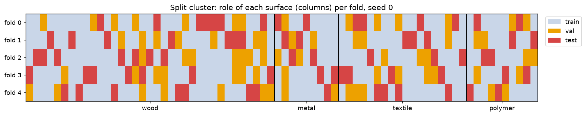
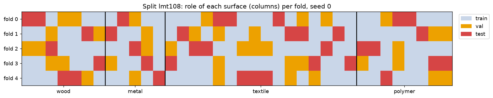
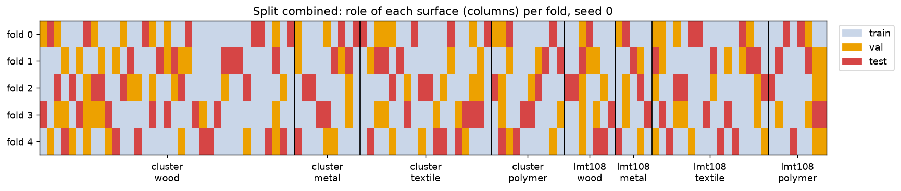

# Surface splits

```bash
uv run python scripts/splits.py
```

Writes `analysis/splits/folds.csv` and the three figures below, using only `analysis/surface_families.csv`.

All recordings of a surface stay together. Probable duplicates also share a group: White ash 8/13,
Cotton 88/104, the LMT108 solid-rubber versions and Beech/CoreBeech. Folds are stratified by dataset
and family; one quarter of the training groups form validation.

| Split | Training source | Test | Folds × seeds |
|---|---|---|---|
| `cluster` | Cluster | New Cluster surfaces | 5 × 3 |
| `cluster`, `new_velocity=True` | Cluster, 20–50 mm/s | New Cluster surfaces, 60 mm/s | 5 × 3 |
| `lmt108` | LMT108 | New LMT108 surfaces | 5 × 5 |
| `combined` | Both | New surfaces of both | 5 × 3 |
| `cluster_to_lmt108` | Cluster | All LMT108 | 1 × 3 |
| `lmt108_to_cluster` | LMT108 | All Cluster | 1 × 3 |

`split_recordings()` selects train, validation and test recordings. The `spectral_models_on_team_splits` and
`cnn_on_team_splits` commands of `scripts/classification/run.py` use these folds and combine
train + validation because their settings are fixed.
The older experiments and pretrained notebook use five surface folds at seed 42, without duplicate
grouping. SENS3 is evaluated separately by the `test_on_sens3` command and the notebooks.

Scores are balanced accuracies per recording, reported separately per test dataset, with 95% intervals
from bootstrapping whole surfaces. Training weights balance each (dataset, family) group. Few test
surfaces per family make the intervals wide; recordings of one surface are not independent examples.




