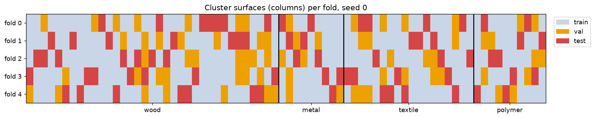

# Train / validation / test splits

Every model uses the same splits, written by `scripts/splits.py` to `folds.csv`:

```bash
uv run python scripts/splits.py
```

The script only reads `analysis/surface_families.csv`, so it runs without the raw data. Models get the
recordings of each role with `split_recordings(recordings, folds, split, seed, fold, new_velocity=False)`.

## Rules

- **Split by surface, not by recording.** All recordings of a surface stay in the same role, so the
  test surfaces are never seen in training. This is the object-wise split from the hyperspectral
  project, with one surface playing the role of one object.
- **Probable duplicates stay together.** In Cluster, surfaces with the same name form one group
  (White ash 8 and 13, Cotton 88 and 104). In LMT108, `SolidRubberPlateVersion1/2` form one group,
  and so do `Beech_0` and `CoreBeech`. That gives 70 groups for the 72 Cluster surfaces.
- **Stratified by family**, with `StratifiedGroupKFold`.
- **Validation surfaces come from the training side.** About a quarter of the training groups are used
  for early stopping and for choosing λ. The test dataset is never used for training or tuning.

## Splits

| `split` | Experiment | Train / val | Test | Folds |
|---|---|---|---|---|
| `cluster` | 1: new Cluster surfaces | Cluster, all velocities | other Cluster surfaces, all velocities | 5 folds × 3 seeds |
| `cluster` + `new_velocity=True` | 2: new surfaces at a new velocity | Cluster, 20–50 mm/s | other Cluster surfaces, 60 mm/s only | same 15 folds |
| `cluster_to_lmt108` | 3a: new setup | Cluster | all 36 kept LMT108 surfaces | 1 fold × 3 seeds (the seed changes the val surfaces) |
| *to do* | 3b: new setup, bare finger | Cluster + LMT108 | SENS3 | waits for SENS3 in `surface_families.csv` |



## Numbers

Cluster surfaces per fold (range over the 15 folds):

| Role | Wood | Metal | Textile | Polymer |
|---|---|---|---|---|
| train | 21 | 5–6 | 10–12 | 6 |
| val | 7 | 1–2 | 3–4 | 2 |
| test | 7 | 1–2 | 3–4 | 2 |

Recordings for seed 0, fold 0:

| Experiment | Train | Val | Test |
|---|---|---|---|
| 1 | 6,880 | 2,240 | 2,400 |
| 2 | 5,504 | 1,792 | 480 |

Cluster → LMT108 (seed 0): 54 Cluster surfaces in train, 18 in val, and 36 LMT108 surfaces in test
(7 wood, 5 metal, 16 textile, 8 polymer).

## What this means for evaluation

- **Few test surfaces per family.** A fold tests 1–2 metal and 2 polymer surfaces, so one surface
  changes a per-family score by 50 % or more. Report mean ± std over the 15 folds, not a single fold.
- **Surfaces are the independent examples.** Thousands of recordings come from only 72 surfaces. Report
  per-surface accuracy, where a surface's prediction is the majority vote of its recordings, alongside
  the per-recording metrics.
- **Imbalanced classes.** Wood is about half of Cluster, so use macro-F1 rather than accuracy.
- **The class balance shifts between datasets.** LMT108 is mostly textile (16 of 36) while Cluster is
  mostly wood, so per-family recall is easier to compare between experiments than overall accuracy.
- **Experiment 2 has a small test set** (480 recordings, one velocity), but the same number of test
  surfaces as experiment 1.

## Proposed baseline: logistic regression

This gives the reference numbers that the CNN and other models have to beat.

## Open questions

- Should the duplicate groups be kept? In particular, `Beech_0` and `CoreBeech` may be different boards.
  Cotton 88 is listed as "Biodegradable" and Cotton 104 as "Cloths".
- Should elastomers stay in "polymer"? They are mostly in LMT108, while Cluster's polymers are rigid
  plastics (see `polymer_type`).
- Which SENS3 surfaces do we keep, and in which families?
